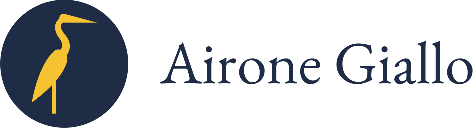

<p align="center">
  <picture>
    <source media="(prefers-color-scheme: dark)" srcset="brand/lockup-dark.svg">
    
  </picture>
</p>

# Airone Giallo

Airone Giallo runs a long project with Claude Code agents: weeks or months of sessions on one codebase, where the
problems are continuity (a session that forgets what was decided), drift (a rule nobody enforces) and trust (a
number nobody measured). It installs whole: a setup that lays out the project's documents, skills that run the
sessions on that layout, and commands that check it. The project chooses which parts it uses when it runs the setup.
Some parts also stand on their own: the specification graph is a package of its own, used by Airone Giallo and usable
without it.

Airone Giallo gives a project a structure and a direction; it does not collect fixes. A rule is here because many
projects meet the case and an agent does not find the answer on its own. What one project learned from its own incidents
belongs in that project's memory, not here.

| What | Where |
|---|---|
| The skills: how a session opens and closes, how a claim is verified, how documents are written, corrected and kept true together, and the setup, which asks a project a few questions and lays out its documents: the system documents, the plan, the AI documents with the status file and the handoff, an archive with its log in each repository, the agent layer | `skills/`, the setup in `skills/setup/` with the templates of every file it writes |
| The commands: four checks for a hook and CI (the status file with its IDs, the archive and its log, the links, with no public document linking to a private one, the frontmatter with its dates), a mover that re-points every reference to a moved file, a mutation round, and a lister of the claims a change makes | `tools/` |
| The specification graph: a project's decisions, requirements, assumptions and threats as a graph whose truth is computed, with a lint, a cascade and a batch tool; a package of its own, with its own skill and plugin entry (`specgraph`) for a project that takes the graph alone | `graph/` |
| The plugin, which carries the skills into Claude Code | `.claude-plugin/` |
| The brand: the mark, its lockups and the rules for using them | `brand/` |

The name is Italian for *yellow heron*: the slender, elegant evolution of the yellow rubber duck. Talking to the duck
bounces your ideas back; the heron does more with them.

## Start

The skills come as one Claude Code plugin; the commands come as two Python packages, since a plugin cannot put a
command on the PATH. In Claude Code:

```
/plugin marketplace add Ev3nt1ne/airone-giallo
/plugin install airone-giallo@airone-giallo
```

Then the commands the project will use, one line per package:

```
uv tool install 'git+https://github.com/Ev3nt1ne/airone-giallo.git#subdirectory=graph'
uv tool install 'git+https://github.com/Ev3nt1ne/airone-giallo.git#subdirectory=tools'
```

From a clone of this repository, `uv tool install ./graph` and `uv tool install ./tools`; `pipx install` takes the
same arguments, and `pip install` works inside a project's own venv. The tool installer comes first because the
system Python on most machines refuses `pip install` outside a venv, and a tool installer keeps the commands'
environment apart from the project's.

The skills are then `/airone-giallo:session`, `/airone-giallo:handoff`, `/airone-giallo:markdown-docs`,
`/airone-giallo:doc-discipline`, `/airone-giallo:setup` and `/airone-giallo:graph`; the commands are `specgraph`,
`check-status`, `check-archive`, `check-links`, `check-frontmatter`, `move-paths`, `mutate` and `claims`. Each
folder's README says what it holds, why, and how it is used, in that order.

To lay Airone Giallo out in a project, open a session at the project's root, on a clean git tree, and run
`/airone-giallo:setup`. It reads the repository, asks only what the repository cannot answer, and shows a dry run that
writes nothing; the real run waits for your word. When only some of the project's documents are to be public, the
project becomes two repositories: a new private one, `<folder>-nido`, is created beside the project's folder, and the
folder moves into it, whole, as its public side. The move is the setup's last step, and it too waits for your yes.

### What it costs in context

The figures below are a dated measurement, not a property of the plugin: Claude Code's own estimate, printed by
`claude plugin details airone-giallo@airone-giallo`, taken on 2026-11-03 for version 0.1.0 of the plugin. About 473
tokens are added to every session; a skill's full text is loaded only when the skill is used:

| Skill | Tokens when used |
|---|---|
| setup (once per project) | about 10.4k |
| doc-discipline | about 4.8k |
| graph | about 2.8k |
| session | about 2.7k |
| markdown-docs | about 2.7k |
| handoff | about 1.8k |

They change with each version of the skills; run the command after installing for the figures of the version you have.

### The graph alone

The graph is also a plugin of its own in the same marketplace, for a project that wants the graph and nothing else:

```
/plugin marketplace add Ev3nt1ne/airone-giallo
/plugin install specgraph@airone-giallo
uv tool install 'git+https://github.com/Ev3nt1ne/airone-giallo.git#subdirectory=graph'
```

The skill is then `/specgraph:graph`, and the command `specgraph`; `pipx install` takes the same argument as
`uv tool install`, and `uvx --from 'git+https://github.com/Ev3nt1ne/airone-giallo.git#subdirectory=graph' specgraph`
runs it with nothing installed. See [graph/README.md](graph/README.md).

## Licence

MIT; see [LICENSE](LICENSE).
